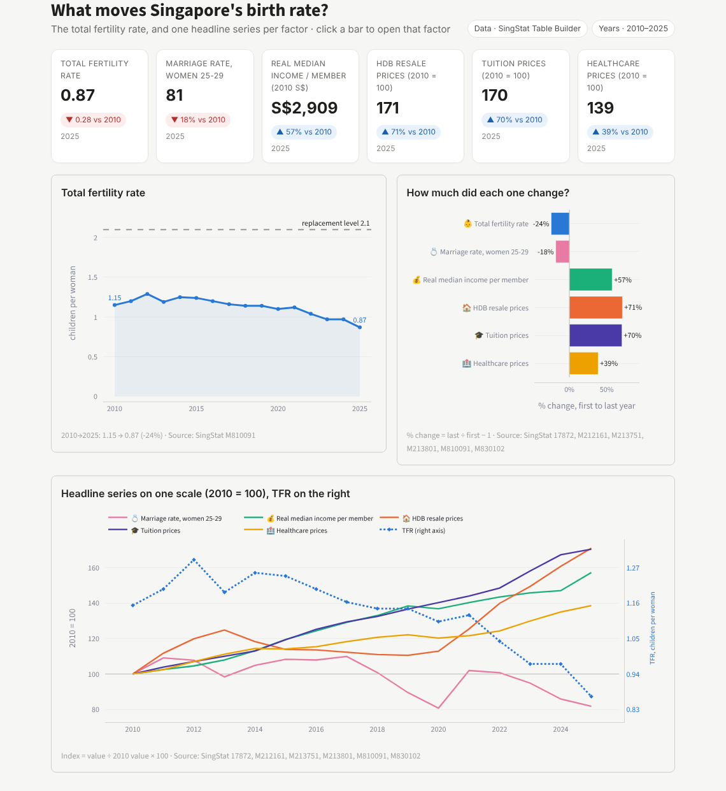

# Singapore Birth Rate Drivers Dashboard

An interactive **Streamlit** dashboard exploring what moves Singapore's falling total fertility rate (TFR), across five factors: healthcare, housing, marriage, income & inequality, and education costs.

*AN6100 Essential Programming · MSc Business Analytics, Nanyang Technological University (2026)*



## What it does

- Combines each team member's SingStat data into one year-by-year table (2000–2025, 111 columns)
- One dashboard page per factor, with filters and varied chart types for users to explore
- Correlations with TFR using Pearson *r* and two-sided *p*-values, in levels or yearly changes, with a 0–3 year lag

## Project lead

**Wang Gaoyang (Kenny)** led the project from planning and dashboard structure to integrating all members' data into one app (built in Python with AI-assisted coding), and owned the **Income & Inequality** factor: real household income per member, income growth by decile and the Gini coefficient.

| Factor | Member |
|---|---|
| Healthcare | Zhou Dianfeng |
| Housing | Angelica Wu |
| Marriage | Tongtong Tang |
| Income & Inequality | Wang Gaoyang |
| Education | Huang Yixuan |

## Run it

```bash
pip install -r requirements.txt
streamlit run SB_Group8_Dashboard.py
```

## Repository layout

| Path | Contents |
|---|---|
| `SB_Group8_Dashboard.py` | The full Streamlit dashboard |
| `Fertility_Combined_Data.csv` | Combined data table, one row per year |
| `Dashboard_Graphs_Merged.ipynb` | All five analyses in one notebook |
| `members/` | Each member's notebook and data |
| `charts/` | All charts, plus dashboard screenshots in `charts/0_Dashboard/` |
| `SB_Group8_Presentation_Deck.pptx` | Final presentation |
| `PROJECT_NOTES.md` | Detailed methods and version notes |

**Data source:** [SingStat Table Builder](https://tablebuilder.singstat.gov.sg/), Department of Statistics Singapore.
